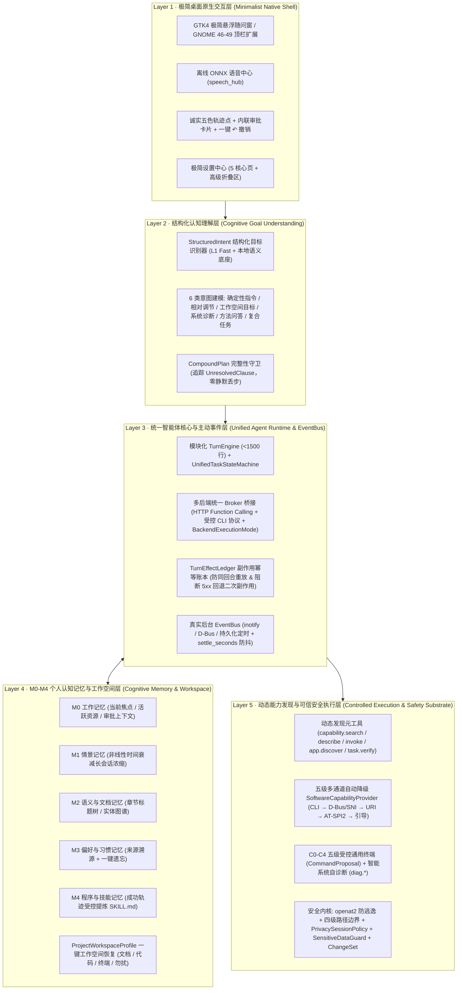

# IntentOS v0.2 架构演进路线图 — 面向 Ubuntu 桌面的个人认知壳层 (Cognitive Shell)

> **版本定位**：从 v0.1「系统开关与单点命令路由器」全面演进为 **IntentOS v0.2 Cognitive Shell（懂个人上下文、能跨软件协同、可验证且可逆的高可信个人桌面认知壳层）**。  
> **GitHub Milestones 看板**：<https://github.com/lbg2002/intentos/milestones>  
> **GitHub Issues 追踪**：<https://github.com/lbg2002/intentos/issues>

---

## 1. 演进愿景与核心判断

在 Linux 桌面环境中，用户并不缺一个“换种方式调音量或开关蓝牙”的命令行包装器；用户真正缺失的是一个**驻留在极简悬浮窗背后、理解当前正在推进的项目与文档、能够安全打通无 CLI 桌面软件与受控终端、且每一步状态变更都诚实可验证并支持一键回滚的个人认知伙伴**。

IntentOS v0.2 围绕以下四条核心工程准则推进架构升级：

1. **大脑可插拔，身体强统一**：无论底层接入云端 OpenAI / Anthropic 接口还是本机 CLI 模型（`ZCode` / `Codex` / `Pi`），所有工具发现、文件读写、软件协同、权限审批、幂等记账与回滚快照均 100% 收口至统一的 `CapabilityBroker`。
2. **从“关键词匹配”升级为“结构化目标理解”**：L1 认知层不再把模糊口语强行塞进单一静态命令，而是识别用户的真实目标态（如进入论文专注状态、排查电脑卡顿、晨间工作接续），保障复合意图零静默丢步。
3. **动态按需发现取代全量静态平铺**：通过 5 个核心元工具（`capability.search / describe / invoke / app.discover / task.verify`）与 C0–C4 受控终端，以更低 Token 开销撬动 95+ 内置能力、本机全量桌面软件与长尾系统排障。
4. **安全、幂等与隐私是不可妥协的底座**：全核心 `#![forbid(unsafe_code)]`，`openat2` 内核级路径防逃逸，`TurnEffectLedger` 阻断故障回退时的重复副作用，`PrivacySessionPolicy` 严格隔离无痕会话读写，`SensitiveDataGuard` 保障高敏凭据零明文落盘。

---

## 2. IntentOS Cognitive Shell 五层目标架构

### 五层职责边界一览

| 架构层级 | 核心定位 | 对应代码模块 | 关键工程不变量 |
| :--- | :--- | :--- | :--- |
| **Layer 1：极简桌面原生交互层** | 保持“单悬浮窗”零打扰心流，诚实呈现每一步推理、记忆与状态验证 | `desktop/gtk-fallback/`、`desktop/gnome-extension/`、`desktop/settings/`、`speech_hub/` | 绝不伪造成功状态；设置中心收敛为 **5 核心页 + 高级折叠区** |
| **Layer 2：结构化认知理解层** | 将自然语言转化为带目标、子目标、隐含约束与路由建议的 `StructuredIntent` | `intent_engine/goal_schema.rs`、`cognitive_parser.rs`、`compound_splitter.rs`、`decision.rs`、`router.rs` | 多子句复合指令 **100% 追踪未决子句**，绝不静默吞步 |
| **Layer 3：统一智能体核心层** | 统一编排 HTTP/CLI 多后端推理、审批挂起续接、副作用账本与后台主动触发 | `backend_bridge/{turn_engine,turn_checkpoint,broker_bridge,providers_http,providers_cli}.rs`、`execution_hub/` | 已产生副作用后遇上游报错**严禁跨后端重放**；后台事件严格防抖限流 |
| **Layer 4：个人认知记忆层** | 贯通 M0–M4 五层个人记忆、动态重要性召回、项目工作空间恢复与技能自沉淀 | `memory_hub/`、`execution_hub/{project_memory,skill_workflow}.rs`、`db.rs` | 无关指令零噪音注入；技能复用**零越权免审继承** |
| **Layer 5：受控能力与安全内核** | 元工具动态发现、五级软件通道降级、C0–C4 终端提案与内核级安全脱敏防线 | `broker.rs`、`policy.rs`、`security_guard.rs`、`app_adapter/`、`crates/fsops/`、`crates/sandbox/` | 全仓 `#![forbid(unsafe_code)]`；高敏密钥磁盘 **0 明文残留** |

---

## 3. 四大演进里程碑与 16 项工程 Issue 拆解

### 里程碑一：[`v0.2-M1: 统一智能体核心与可信底座加固`](https://github.com/lbg2002/intentos/milestone/1)

> **核心目标**：清偿全部 P0 架构债务与安全/幂等/隐私/丢步隐患，完成 5,000 行 `turn_engine.rs` 模块化拆分，统一多后端 `CapabilityBroker` 受控接口并建立 L1 `StructuredIntent` 认知底座。

| Issue | 模块域 | 任务标题与交付重点 |
| :---: | :--- | :--- |
| [#1](https://github.com/lbg2002/intentos/issues/1) | `architecture` · `agent-runtime` | **[M1][Architecture] 拆分 5000 行 `turn_engine.rs` 为模块化智能体运行时与协议层** 拆分为 `turn_checkpoint`、`broker_bridge`、`providers_http`、`providers_cli` 与 `< 1,500` 行 `turn_engine.rs`，保持 100% 公共符号向后兼容。 |
| [#2](https://github.com/lbg2002/intentos/issues/2) | `agent-runtime` · `P0-correctness` | **[M1][Agent Core] 统一大脑与身体接口：多后端受控 `CapabilityBroker` 桥接与 CLI 模式显式标识** 打通 CLI 后端受控 `<intentos_tool_call>` 协议与内联审批断点续接，落地 `BackendExecutionMode` 与 `UnifiedTaskStateMachine`。 |
| [#3](https://github.com/lbg2002/intentos/issues/3) | `P0-correctness` · `agent-runtime` | **[M1][P0 Safety] 引入 `TurnEffectLedger` 副作用账本与幂等键，阻断后端失败回退时的重复副作用执行** 基于 SHA-256 幂等键去重同回合重复写调用，并在已提交副作用后遇 HTTP 5xx 时硬性熔断跨后端回退重放，完整保留 `changeset_ids` 供撤销。 |
| [#4](https://github.com/lbg2002/intentos/issues/4) | `P0-correctness` · `memory` | **[M1][P0 Privacy & Security] 完善三级隐私会话记忆隔离与全链路 `SensitiveDataGuard` 落盘脱敏** 实现 `PrivacySessionPolicy`（确保 `incognito` 无痕会话零读取零写入），并在 `state.db` / `memory_hub.db` 全存储入口强制脱敏敏感凭据。 |
| [#5](https://github.com/lbg2002/intentos/issues/5) | `cognition` · `P0-correctness` | **[M1][Cognition & P0] 重构 L1 为结构化目标识别器 (`StructuredIntent`) 并修复复合意图静默丢步** 新增 `goal_schema.rs` 与 `cognitive_parser.rs`，升级 `CompoundPlan` 追踪 `unresolved_clauses`，校准内网 IP、省电续航与复杂方法提问路由。 |

---

### 里程碑二：[`v0.2-M2: 动态能力发现与受控系统执行`](https://github.com/lbg2002/intentos/milestone/2)

> **核心目标**：打破静态工具列表瓶颈，赋予智能体按需能力发现、C0–C4 五级受控终端执行、系统故障自诊断以及五级自动降级的桌面软件协同能力。

| Issue | 模块域 | 任务标题与交付重点 |
| :---: | :--- | :--- |
| [#6](https://github.com/lbg2002/intentos/issues/6) | `meta-tools` · `agent-runtime` | **[M2][Meta-Tools] 建立动态能力发现元工具体系 (`capability.search / describe / invoke / app.discover / task.verify`)** 降低 50%+ 初始工具 Schema Token 开销，按需检索调用 95+ 内置能力与本地软件，并引入独立环境状态后置验证 `task.verify`。 |
| [#7](https://github.com/lbg2002/intentos/issues/7) | `meta-tools` · `P0-correctness` | **[M2][Terminal Agent] 实现 C0-C4 五级受控通用终端执行模块 (`CommandProposal`)** 以参数数组化提案、本地确定性风险分级器、`bwrap` 只读/路径沙箱与强制审批门禁安全释放 Linux 命令行排障与开发辅助潜力。 |
| [#8](https://github.com/lbg2002/intentos/issues/8) | `cognition` · `meta-tools` | **[M2][Diagnostics] 智能 Linux 系统与软件故障自诊断与修复验证能力族** 围绕系统卡顿、磁盘满载、桌面软件启动闪退（如环境变量污染）与音频/网络异常构建只读证据采集与可验证修复闭环。 |
| [#9](https://github.com/lbg2002/intentos/issues/9) | `app-provider` · `architecture` | **[M2][App Provider] 将 `app_adapter` 从“控制软件”升级为五级多通道自动降级 `Software Capability Provider`** 建立 `CLI/Headless → MPRIS2/SNI-DBusMenu → URI/.desktop → 纯净环境 AT-SPI2/Wnck → 诚实引导` 自动降级状态机与置信度回执。 |

---

### 里程碑三：[`v0.2-M3: M0-M4 个人认知记忆与工作空间恢复`](https://github.com/lbg2002/intentos/milestone/3)

> **核心目标**：让 IntentOS 真正记住用户的活跃项目、文档章节、长期偏好与成功经验，打通「每日认知简报与工作接续」北极星闭环体验。

| Issue | 模块域 | 任务标题与交付重点 |
| :---: | :--- | :--- |
| [#10](https://github.com/lbg2002/intentos/issues/10) | `memory` · `cognition` | **[M3][Memory] 构建 M0-M4 五层个人认知记忆架构与多维重要性动态召回** 统一工作记忆、情景记忆、语义与文档记忆、偏好习惯记忆、程序技能记忆，按相关性×时间衰减×重要性×项目作用域在严格预算内精准召回。 |
| [#11](https://github.com/lbg2002/intentos/issues/11) | `memory` · `app-provider` | **[M3][Workspace] 个人项目记忆接入与一键工作空间恢复（文档 / 代码 / 终端 / 勿扰专注模式）** 维护 `ProjectWorkspaceProfile`，支持非破坏性增量唤醒目标文档章节、代码仓、终端工作目录并联动可逆勿扰专注状态。 |
| [#12](https://github.com/lbg2002/intentos/issues/12) | `memory` · `meta-tools` | **[M3][Skills] 从成功任务中自动沉淀、校验与复用受控技能 (Skill Learning)** 从经验证未撤销的成功轨迹中剪枝提炼参数化 `SKILL.md` 候选卡片，经用户确认入库，复用时逐跳严格重验 `PolicyEngine` 权限边界。 |
| [#13](https://github.com/lbg2002/intentos/issues/13) | `north-star` · `cognition` · `memory` | **[M3][North-Star Epic] 每日认知简报与工作接续端到端验收（「看天气给穿衣建议 + 定位当前研究项目待办 + 一键恢复工作空间」）** 贯穿五层架构的标志性端到端验收闭环，验证多目标协同、真实记忆溯源、断网优雅降级与环境一键回滚。 |

---

### 里程碑四：[`v0.2-M4: 主动式事件总线、极简设置与 AgentBench`](https://github.com/lbg2002/intentos/milestone/4)

> **核心目标**：实现低功耗防风暴的真实后台事件感知，完成设置中心从 11 页向 5 核心页的认知减负，并以四层环境状态验证型 `IntentOS AgentBench` 建立客观量化门禁。

| Issue | 模块域 | 任务标题与交付重点 |
| :---: | :--- | :--- |
| [#14](https://github.com/lbg2002/intentos/issues/14) | `proactive-aios` · `agent-runtime` | **[M4][Proactive AIOS] 真实后台 `EventBus`（`inotify` / D-Bus / `systemd`）、真实 `settle_seconds` 防抖与持久化调度循环** 打通文件落地监听（过滤未完成下载临时态）、桌面状态信号与持久化定时任务，落地真实防抖聚合器与 `AutonomyLevel` 安全门禁。 |
| [#15](https://github.com/lbg2002/intentos/issues/15) | `ux-simplification` · `architecture` | **[M4][UX Simplification] 设置中心减负：将 11 页收敛为 5 个核心页（大脑、记忆、软件能力、安全权限、自动任务）+ 高级折叠区** 大幅降低首次上手认知负担，保留 100% 底层配置兼容性并通过 GTK4 UI 冒烟门禁。 |
| [#16](https://github.com/lbg2002/intentos/issues/16) | `agentbench` · `P0-correctness` | **[M4][AgentBench] 建立四层 `IntentOS AgentBench`（以环境状态验证 Goal Success Rate 为核心指标）** 构建认知路由、环境状态验证执行、跨会话记忆与工作空间、对抗安全与故障注入四层评测基准，守住安全与零泄露 100% 红线。 |

---

## 4. 北极星验收场景：「每日认知简报与工作接续」

IntentOS v0.2 以一个每天清晨真实发生的高价值场景检验全栈协同质量（详见 [Issue #13](https://github.com/lbg2002/intentos/issues/13)）：

- **自然语言输入**：
  > *「帮我看下今天的天气，告诉我早上出门穿什么衣服，然后告诉我今天最应该优先完成哪些任务，顺便把论文写作的工作环境准备好。」*
- **五层协同验收标准**：
  1. **零丢步认知拆解**：L1 `StructuredIntent` 准确识别 `CompoundTask` + `GoalWorkspace` 三段子目标并升级 L2 统一规划，不因前段查询成功而遗漏后段工作区恢复；
  2. **外部感知与个人上下文融合**：结合实时天气温差给出简洁穿衣建议，并从 M1–M3 个人认知记忆与活跃 `ProjectWorkspaceProfile` 中真实召回上次停留的论文章节与高优待办（附可溯源紫色轨迹点）；
  3. **克制可逆的桌面协同**：通过 `SoftwareCapabilityProvider` 增量唤醒目标文档、代码编辑器与项目终端，开启系统勿扰专注模式，绝不强关任何已有运行程序，且点击 `↶ 撤销` 可一键还原通知设置；
  4. **部分故障诚实降级**：若当前处于离线无网状态，诚实说明天气暂不可用，同时继续高质量交付本地待办梳理与工作空间恢复。

---

## 5. 架构边界与明确「暂缓方向」纪律表 (Explicit Non-Goals)

为保持 IntentOS 轻盈、可信、可维护的工程品质，v0.2 明确划定以下 **“不做/暂缓方向”** 边界：

| 暂缓 / 不做方向 | 明确排除的具体形态 | 架构取舍理由 |
| :--- | :--- | :--- |
| **自造操作系统内核或桌面合成器** | 不修改 Linux Kernel，不替代 `systemd`、GNOME Shell Mutter 或发行版包管理器 | 坚守 **Ubuntu/GNOME 用户态轻量 Cognitive Shell** 定位，确保 `apt` / 用户态一键无侵入安装与卸载 |
| **全屏视觉截图 + 像素坐标盲点 GUI Agent** | 不以高频全屏截图送多模态模型猜 `(x, y)` 像素坐标模拟鼠标乱点作为主路径 | 像素盲点延迟高、功耗大、易受窗口遮挡误触且不可验证；坚持 **CLI → D-Bus/SNI → URI → AT-SPI2 语义树** 五级可验证通道优先 |
| **重型多智能体群聊与流程图拖拽画布** | 不在产品内引入复杂的多角色 Agent 互聊剧场或低代码节点连线编排器 | 桌面助理的核心是极低摩擦地解决问题；坚持**单一高可靠智能体核心 + 自然语言 / 声明式 `SKILL.md`** |
| **无边界 `root` 特权或裸 `bash -c` 放行** | 不存储用户 `sudo` 明文密码，不向模型暴露未经 `CommandProposal` 分级的裸 Shell，不允许后台主动任务静默执行高危变更 | 安全与可逆是桌面 AIOS 的生命线；C3 强审批、C4 硬阻断与 `AutonomyLevel` 门禁永不妥协 |
| **强制云端记忆同步或重型外部数据库依赖** | 不把个人文件索引/记忆上传第三方云存储，不要求用户部署 Docker / PostgreSQL / 独立向量数据库服务 | 坚守 **100% 本地 SQLite 单机数据主权**，保证守护进程毫秒级冷启动与极低内存占用 |
| **重造全套办公软件、浏览器或代码编辑器** | 不内置自研富文本编辑器、内置浏览器内核或全屏重型 Web 工作台 | IntentOS 是**连接与唤醒用户熟悉软件（WPS / VS Code / 浏览器 / 阅读器）的认知粘合层**，而非替代品 |
